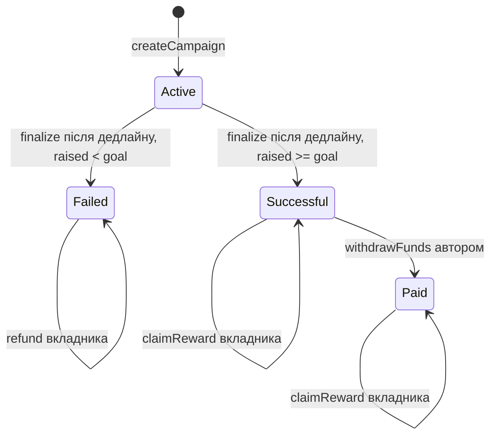

# Збори коштів — практичне заняття №2

Сценарій A: краудфандинг із поверненням коштів. Три контракти Ethereum, вебзастосунок із MetaMask та REST API на TypeScript.

## Що робить система

Автор відкриває збір і задає ціль у ETH та дедлайн. Вкладники надсилають ETH безпосередньо в контракт. Після дедлайну будь-хто фіксує результат. Якщо ціль досягнута, автор сам забирає весь збір, а кожен вкладник окремо забирає токени CFR. Якщо цілі не досягнуто, кожен вкладник сам повертає свій внесок.

1 ETH внеску відповідає 1 CFR винагороди, обидва мають 18 десяткових знаків. CFR — навчальний токен без гарантованої грошової вартості. Повернення внеску не повертає витрачений газ.

## Ролі та сценарії

| Роль | Можливості |
| --- | --- |
| Адміністратор | Керує модераторами та правом карбування токенів |
| Модератор | Надає й відкликає роль автора, вмикає та вимикає паузу |
| Автор | Створює кампанії, отримує кошти власних успішних кампаній |
| Вкладник | Робить внески, повертає їх після провалу, отримує CFR після успіху |
| Релеєр | Оплачує газ створення кампанії за EIP-712 підписом автора |

Адміністратор і модератор — довірені ролі. Адміністратор токена технічно може надати право карбування іншій адресі. Відкликання ролі автора забороняє нові збори, але не забирає його право на вже зібрані кошти.

Користувацькі сценарії:

1. Модератор надає перевіреному гаманцю роль автора.
2. Автор створює кампанію з назвою, додатною ціллю та дедлайном до 365 днів.
3. Вкладник робить один або декілька внесків до дедлайну.
4. Користувач фіксує результат після дедлайну; досягнення цілі раніше не закриває збір.
5. Автор успішної кампанії сам забирає ETH одноразовою транзакцією.
6. Вкладник неуспішної кампанії сам повертає свій внесок.
7. Вкладник успішної кампанії одноразово отримує CFR до або після виплати автору.
8. Автор підписує створення кампанії; релеєр надсилає транзакцію й оплачує газ.
9. Модератор зупиняє нові збори й внески; завершення, повернення та виплати залишаються доступними.
10. Користувач бачить актуальні кампанії й історію подій, яка автоматично оновлюється.



## Структура

| Шлях | Призначення |
| --- | --- |
| `contracts/CreatorRegistry.sol` | Ролі OpenZeppelin AccessControl |
| `contracts/RewardToken.sol` | Токен ERC-20, карбування через MINTER_ROLE |
| `contracts/Crowdfunding.sol` | Кампанії, ETH, повернення, пауза, EIP-712 |
| `contracts/interfaces/` | Окремий Solidity-інтерфейс у кожному файлі |
| `contracts/security/` | Навчальна вразлива версія та атакувальник, не розгортаються робочим скриптом |
| `contracts/benchmarks/` | Дві контрольні версії для вимірювання оптимізацій |
| `apps/api/src/database/` | PostgreSQL, пул з’єднань і версійовані SQL-міграції |
| `Dockerfile` | Збірка контрактів і окремий образ API з робочими залежностями |
| `compose.yaml` | API для Sepolia та PostgreSQL 18 із постійним томом |
| `compose.local.yaml` | Налаштування API для локального Hardhat |
| `apps/api/src/modules/` | Модулі кампаній, індексації подій та релеєра |
| `apps/web/src/modules/` | Гаманець і відображення кампаній |
| `shared/interfaces/` | Типи даних, один інтерфейс на файл |
| `shared/constants/` | Окремі логічні групи констант |
| `scripts/` | Розгортання, верифікація, демонстрація, перевірки газу й покриття |
| `test/` | Контрактні тести та інструменти вимірювання |
| `apps/api/test/` | Перевірки HTTP-обробників, релеєра та реального читання блокчейну |

Crowdfunding викликає реєстр через ICreatorRegistry та токен через IRewardToken. Реєстр і токен не мають потреби викликати один одного. ETH зберігається в Crowdfunding. Клієнт підписує транзакції через MetaMask; сервер не отримує ключ користувача. API формує модель читання, індексує події та надає окрему операцію релеєра.

## Запуск у WebStorm

Потрібні Node.js 22.13+, Docker з Docker Compose і MetaMask у браузері. Команди виконуй у терміналі WebStorm у корені цього проєкту.

Встанови пакети для вебклієнта та скриптів:

```sh
npm ci
```

Під час першого налаштування створи `.env` зі зразка. Для наявного проєкту використовуй свій заповнений файл.

```sh
cp .env.example .env
```

### Sepolia

Відкрий Docker Desktop і дочекайся готовності. У `.env` має бути заданий `SEPOLIA_RPC_URL`; адреси вже розгорнутих контрактів беруться з `deployments/11155111.json`. Якщо раніше API був запущений вручну, зупини той процес, щоб звільнити порт 3001.

Запусти API та PostgreSQL однією командою:

```sh
npm start
```

Це скорочення для `docker compose up -d --build --wait --force-recreate api`. Образ API сам компілює контракти під час збірки. PostgreSQL спочатку проходить перевірку готовності, після цього API застосовує міграції, перевіряє мережу та контракти й індексує події. Повторний запуск API перечитує актуальні адреси розгортання. Команда завершується після успішних перевірок обох сервісів. Контейнери працюють у фоні; окремі `db:up`, `db:migrate` та `api:sepolia` для цього запуску не потрібні.

В іншому терміналі запусти вебклієнт:

```sh
npm run web
```

Відкрий [http://localhost:5173](http://localhost:5173). API доступний на [http://localhost:3001/api/health](http://localhost:3001/api/health). У MetaMask вибери Sepolia.

Перегляд журналу API та зупинка сервісів:

```sh
npm run logs
npm stop
```

`npm stop` зберігає том PostgreSQL. Наступний запуск — знову `npm start`. Docker-контекст не містить `.env`, приватних ключів, файлів звіту чи вебклієнта; сервер отримує потрібні налаштування під час запуску. Ключ deployer і ключ Etherscan в API не передаються. `RELAYER_PRIVATE_KEY` потрібен лише для створення кампаній за підписом; без нього звичайні транзакції працюють.

### Локальний Hardhat

Перший термінал містить локальну мережу. Параметр hostname дозволяє API в Docker Desktop звернутися до неї через `host.docker.internal`. Ця мережа та її загальновідомі тестові ключі призначені лише для навчальної локальної перевірки.

```sh
npm run node -- --hostname 0.0.0.0
```

В іншому терміналі скомпілюй і розгорни контракти, а потім запусти API та БД:

```sh
npm run compile
npm run deploy:local
npm run start:local
npm run web
```

`start:local` використовує `compose.local.yaml`, локальний RPC і `deployments/31337.json`. `deploy:local` також надає Crowdfunding право карбувати CFR. Типово адміністратор і модератор — перший акаунт локальної мережі.

У MetaMask додай локальну мережу:

| Поле | Значення |
| --- | --- |
| Назва | Hardhat Local |
| RPC URL | `http://127.0.0.1:8545` |
| Chain ID | `31337` |
| Валюта | `ETH` |

Імпортуй два тестові акаунти з ключами, які надрукував `npm run node`. Це загальновідомі навчальні акаунти: використовуй їх лише в локальній мережі. Перший буде модератором та автором, другий — вкладником.

Якщо перезапустив блокчейн, повтори `deploy:local` та `start:local`. Якщо MetaMask пам’ятає старі nonce, очисти історію активності цього тестового акаунта в налаштуваннях MetaMask. Індекс нового розгортання зберігається окремо від попереднього.

## Перевірка у браузері по кроках

1. Підключи перший акаунт MetaMask. Кнопка «Керування» з’явиться після підключення гаманця модератора. Відкрий її: власний гаманець підставиться автоматично. Перевір статус доступу. Якщо дозволу ще немає, натисни «Дозволити створення зборів» і підтвердь у MetaMask — після підтвердження вікно закриється автоматично. Якщо доступ уже є, повторна дія недоступна. Нижче показано всіх чинних авторів; можна додати кілька гаманців. Для відкликання доступу натисни × біля конкретного автора та підтвердь у MetaMask — він зникне зі списку, а вікно залишиться відкритим.
2. Натисни «Створити збір» і заповни форму в модальному вікні з ціллю `0.01` ETH і дедлайном через кілька хвилин. Календар допускає майбутній час у межах 365 днів; обмеження оновлюються при відкритті форми та фокусі поля. Перед підписанням дата перевіряється повторно, а контракт незалежно перевіряє час блоку.
3. Перемкни MetaMask на другий акаунт і внеси `0.01` ETH. Статус покаже очікування, потім підтвердження.
4. Дочекайся дедлайну. Натисни «Підбити підсумки».
5. Перемкнись на автора та натисни «Отримати зібрані кошти».
6. Перемкнись на вкладника та натисни «Отримати винагороду». Його баланс CFR зросте на `0.01`.
7. Для повернення створи іншу кампанію з ціллю `1` ETH. Внеси `0.001` ETH другим акаунтом.
8. Після дедлайну дочекайся кнопки підбиття підсумків і зафіксуй результат і натисни «Повернути мій внесок» від вкладника.
9. Відкрий вкладку «Історія». У ній відображаються зрозумілі назви дій, збори, суми та дати. «Показати ще» завантажує наступні 20 записів через offset/limit; total використовується лише для визначення наявності наступної сторінки й не показується на сайті. Ваш внесок відображається на картці збору після підключення гаманця.
10. Від модератора відкрий «Керування» й натисни «Призупинити»: новий внесок буде відхилено зі зрозумілим поясненням. Натисни «Відновити приймання» для продовження.

Повідомлення автоматично зникають: успіх через 4 секунди, інформаційні через 6, помилки через 7. Списки зборів, історії та авторів мають обмежену висоту й прокручуються всередині; підвантаження історії не збільшує висоту сторінки. У «Мій гаманець» окремо видно тестовий ETH та винагороди CFR.

Після перемикання акаунта не потрібне ручне перезавантаження сторінки. При зміні мережі сторінка перевіряє Chain ID заново.

## EIP-712 і релеєр

У `.env` задай `RELAYER_PRIVATE_KEY` окремого тестового гаманця, на якому є ETH для газу. Перезапусти API. Вставляти ключ у TypeScript або у файли вебклієнта не потрібно.

Автор відкриває «Створити збір», заповнює форму та обирає «Створити без оплати комісії». Цей варіант з’являється лише коли релеєр доступний. MetaMask просить підпис даних, а не оплату транзакції. Контракт перевіряє автора, параметри кампанії, домен мережі та контракту, строк дії підпису й nonce. Сервер перевіряє транзакцію через staticCall, потім надсилає її своїм гаманцем. Один підпис не можна використати двічі. Ліміт — один успішно надісланий запит на автора за хвилину; цей ліміт у пам’яті одного процесу.

## REST API

| Метод | URL | Результат |
| --- | --- | --- |
| GET | `/api/health` | Стан процесу API |
| GET | `/api/config` | Chain ID, адреси контрактів, доступність релеєра |
| GET | `/api/campaigns?offset=0&limit=20` | Сторінка кампаній та загальна кількість |
| GET | `/api/campaigns/0` | Одна кампанія |
| GET | `/api/campaigns/0/contributors/0x…` | Внесок і стан отримання винагороди |
| GET | `/api/creators?offset=0&limit=20` | Чинні автори з пагінацією |
| GET | `/api/creators/0x…` | Адреса та поточний дозвіл на створення зборів |
| GET | `/api/events/activity?offset=0&limit=20` | Історія для користувача без службових подій; items, total, offset, limit |
| GET | `/api/events?offset=0&limit=20` | Сторінка історії та номер індексованого блоку |
| GET | `/api/events/stream` | SSE-повідомлення про оновлення |
| POST | `/api/relay/campaigns` | Надсилання підписаного створення кампанії, HTTP 202 і transactionHash |

Суми у відповідях — десяткові рядки в wei: вони не проходять через JavaScript number. Сторінка містить максимум 100 записів. ID кампаній починаються з нуля; інтерфейс показує зручну нумерацію з одиниці.

Тіло POST-запиту релеєра:

```json
{
  "creator": "адреса автора",
  "title": "Назва кампанії",
  "goal": "10000000000000000",
  "deadline": 2000000000,
  "expiresAt": 1999999900,
  "signature": "0x…"
}
```

Це схема даних, а не готовий підпис. Реальні строки, nonce та підпис формує вебклієнт. Помилки мають поле `message`; валідація повертає 400, відсутній ресурс — 404, контрактна відмова — 422, обмеження релеєра — 429, відключений релеєр — 503.

## PostgreSQL

Серверні дані зберігаються в PostgreSQL 18. `compose.yaml` запускає API та БД в окремих контейнерах. API звертається до БД за ім’ям `postgres` на внутрішньому порту 5432. На хості БД доступна через `127.0.0.1:5432` для тестів та локальних інструментів. Ім’я БД, користувач і пароль беруться з `.env`; усередині API контейнерні `PGHOST=postgres` та `PGPORT=5432` задаються автоматично. Іменований том `postgres-data` зберігається між перезапусками.

Для окремого запуску тільки БД і застосування міграцій із хоста:

```sh
npm run db:up
npm run db:migrate
```

`db:up` очікує готовності БД через healthcheck. API також автоматично застосовує відсутні міграції перед запуском. Застосовані міграції мають контрольні суми; змінювати вже застосований SQL-файл не можна — потрібно додавати наступну міграцію.

| Таблиця | Дані |
| --- | --- |
| `index_deployments` | Мережа, розгортання та підтверджена позиція індексації |
| `indexed_events` | Події контрактів з унікальними transaction hash і log index |
| `campaigns` | Модель читання зборів, точні суми у wei та стан |
| `creators` | Чинні автори з доступом |
| `schema_migrations` | Версії та контрольні суми міграцій |

Пагінація зборів, історії й авторів використовує SQL `LIMIT`, `OFFSET` та `COUNT(*)`. Записи сторінки й загальна кількість читаються в одній транзакції з узгодженим знімком. Суми зберігаються як `numeric(78,0)` і передаються клієнту рядками без втрати точності.

Індексатор читає блоки пакетами до 2000. Події, проєкції зборів і авторів та checkpoint записуються в одній транзакції. Унікальні ключі захищають від дублікатів; advisory lock координує різні процеси індексатора. Помилка запису відкочує пакет повністю. При реорганізації події та проєкції відповідного розгортання перебудовуються. Різні мережі та розгортання мають окремі простори даних в одній БД.

Кошти та правила виплат залишаються у смарт-контрактах. Індивідуальні внески та права на виплати перевіряються безпосередньо в блокчейні. PostgreSQL зберігає серверну модель читання; JSON-файли історії не використовуються. Після переходу старі `deployments/events-*.json` не імпортуються: історія повторно індексується з блокчейну.

```sh
npm run db:down
```

Зупинка через `db:down` або `npm stop` зупиняє контейнери та зберігає Docker-том із даними. Для повного наступного запуску використовуй `npm start` або `npm run start:local`. Перехід між Hardhat і Sepolia не потребує іншої БД або очищення таблиць.

## Перевірки

```sh
npm test
npm run test:api
npm run coverage
npm run check:coverage
npm run gas
npm run gas:compare
npm run demo
npm run build
```

`npm test` перевіряє 68 контрактних сценаріїв. `test:api` перевіряє 42 сценарії API, PostgreSQL-індексатора та релеєра. Перед запуском потрібна працююча БД (`npm run db:up`). Тести створюють окремі тимчасові SQL-схеми й не очищають дані застосунку. За потреби окрему тестову БД можна задати через `TEST_DATABASE_URL`. HTTP-обробники тестуються без відкриття HTTP-порту; перевірки індексації використовують PostgreSQL і локальний EVM. Вони перевіряють відновлення після перезапуску, реорганізацію, паралельну індексацію, відкат транзакції, ізоляцію розгортань та пагінацію понад 100 записів.

Покриття вимірює стандартний `solidity-coverage 0.8.17` з Istanbul. Ті самі 68 сценаріїв запускаються через Mocha в ізольованому Hardhat 2.26.3; робоча мережа, збірка та звичайні тести використовують Hardhat 3. Для інструментування потрібен окремий набір залежностей `quality/contracts-coverage`, який встановлюється через `npm ci` автоматично під час першого запуску `coverage`. Версії закріплені окремим lock-файлом. Кеш і налаштування цього інструмента залишаються всередині проєкту.

Результат: 100% рядків усіх трьох контрактів; гілки — CreatorRegistry 100%, RewardToken 100%, Crowdfunding 96,15%. Вимірювання включає інструментовані складені умови, а не лише окремі `if`. Код бібліотек OpenZeppelin і навчальні контрольні версії не входять у метрику власних production-контрактів. HTML-звіт — `coverage/index.html`, стандартні дані — `coverage.json`, підсумок — `coverage/summary.json`. `check:coverage` перевіряє мінімум 90% рядків і гілок окремо для кожного контракту. Робочі artifacts не інструментуються.

`gas` записує фактичний gasUsed успішних транзакцій за функціями в `evidence/gas.json`. `gas:compare` порівнює дві найдорожчі робочі функції створення з контрольними версіями: пакування address/deadline/state та immutable-адреси залежностей. У `evidence/gas-comparison.json` є загальний газ і газ виконання без базової вартості calldata; це усуває різницю від байтів EIP-712 підпису. Порівняння завершується помилкою, якщо оптимізації не зменшили газ.

`demo` автоматично проходить успішний і неуспішний збір від автора та вкладника, перевіряє повернення, CFR і нульовий кінцевий баланс контракту. Транзакції записуються у `evidence/demo.json`. Це ізольована мережа в пам’яті, яка зникає після завершення команди.

`deploy:simulation` додатково дозволяє перевірити саме скрипт розгортання без постійного RPC. Його `deployments/simulation-31337.json` не використовуй для запуску API.

## Slither

```sh
python3 -m venv .venv
.venv/bin/python -m pip install -r requirements-dev.txt
npm run compile
npm run slither
```

Використовується Slither 0.11.6 з підтримкою Hardhat 3. Скрипт аналізує тільки поточні compiler build-info трьох основних контрактів, без старих інкрементальних збірок. Навчальна вразлива версія, атакувальник, benchmark-копії та залежності відфільтровані з результатів production-коду.

Фактичний аналіз завершено: 6 зауважень, високих і середніх немає. Чотири зауваження `timestamp` відповідають необхідним дедлайнам кампаній і підписів. Два `low-level-calls` відповідають pull-виплатам ETH, захищеним checks-effects-interactions, перевіркою результату та `nonReentrant`. Для кожного конкретного результату збережено окремий розбір у `evidence/slither-review.json`, початкові дані — `evidence/slither.json`. Новий невідомий тип зауваження або рівень High/Medium завершує перевірку помилкою, а не приймається автоматично.

## Sepolia

Використовуй власний тестовий гаманець, не акаунти локального Hardhat. Отримай тестовий ETH та заповни `.env`:

| Змінна | Що вказати |
| --- | --- |
| `SEPOLIA_RPC_URL` | RPC-провайдер Sepolia |
| `DEPLOYER_PRIVATE_KEY` | Приватний ключ тестового deployer |
| `ETHERSCAN_API_KEY` | Ключ API Etherscan |

Адміністратором нового розгортання завжди стає гаманець deployer. Типово він також є модератором. Якщо потрібен окремий початковий модератор, додай до `.env` необов’язковий `MODERATOR_ADDRESS` з його публічною адресою. Порожнє значення не потрібне. Адреса перевіряється до надсилання транзакцій; нульова адреса заборонена. Ролі вже розгорнутих контрактів зберігаються у блокчейні й не змінюються редагуванням `.env`.

```sh
npm run check:sepolia
npm run deploy:sepolia
npm run verify:sepolia
```

Для запуску застосунку з уже розгорнутими контрактами Sepolia використовуй:

```sh
npm start
npm run web
```

Команда запуску API використовує `SEPOLIA_RPC_URL` і `deployments/11155111.json`, залишаючи локальні налаштування `.env` без змін. Для повернення до локальної мережі виконай `npm run start:local` після запуску Hardhat і локального розгортання. Вебклієнт можна залишити працювати; після перемикання API онови сторінку. У MetaMask обери мережу та гаманець відповідного розгортання.

Для налагодження поза контейнером залишені `npm run api` і `npm run api:sepolia`. Перед ними запусти тільки БД через `npm run db:up`; контейнер API має бути зупинений (`docker compose stop api`), щоб звільнити його порт.

Скрипт розгортання зберігає для кожного контракту точний compiler input, версію компілятора, адресу й аргументи конструктора в `deployments/verification-11155111.json`. Верифікація використовує цей знімок, незалежно від подальших змін `.env` або повторної компіляції, і перевіряє результат через Etherscan API v2. Підтверджені посилання записуються в `evidence/sepolia-verification.json`. Повторна верифікація вже підтвердженого контракту допускається. Локальний deploy не використовує Sepolia-ключ.

Фактичне розгортання Sepolia та верифікацію всіх трьох контрактів виконано 16.11.2026. Chain ID — 11155111; перший блок розгортання — 12148440. Deployer і модератор: `0xF2476fd4470fba200D32e4B03c3815d07DDdAa97`.

| Контракт | Верифікований код |
| --- | --- |
| CreatorRegistry | [0x1e105eA28d9CCBed07A615Ab5405eF95831994Ca](https://sepolia.etherscan.io/address/0x1e105eA28d9CCBed07A615Ab5405eF95831994Ca#code) |
| RewardToken | [0x9096fbf9d56ec6De8E2264E9365D732885FD5336](https://sepolia.etherscan.io/address/0x9096fbf9d56ec6De8E2264E9365D732885FD5336#code) |
| Crowdfunding | [0x09f20fE3C088aC23840a24c893f909761cE4f994](https://sepolia.etherscan.io/address/0x09f20fE3C088aC23840a24c893f909761cE4f994#code) |

Перевірено наявність коду кожного контракту, роль модератора та MINTER_ROLE для Crowdfunding. Підтвердження верифікації — `evidence/sepolia-verification.json`.
